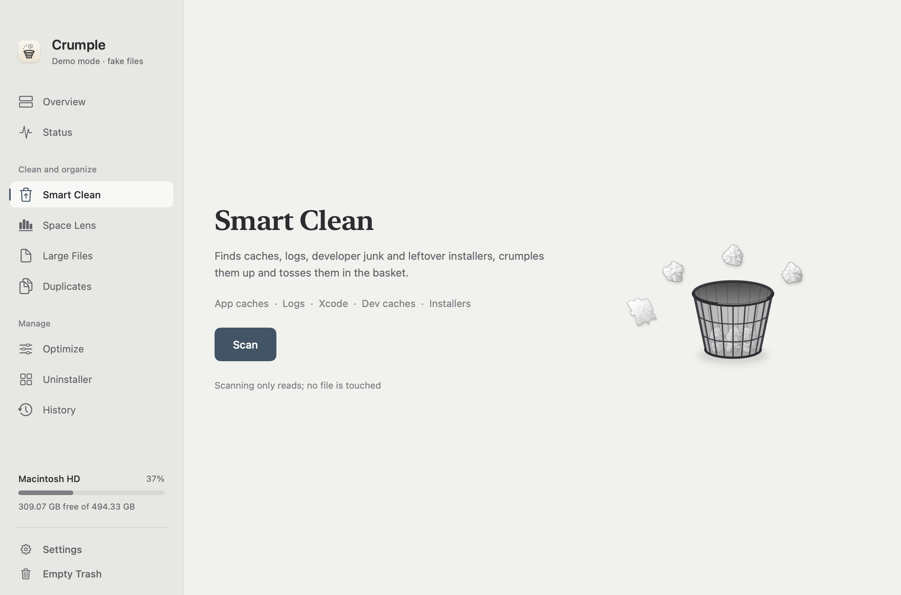
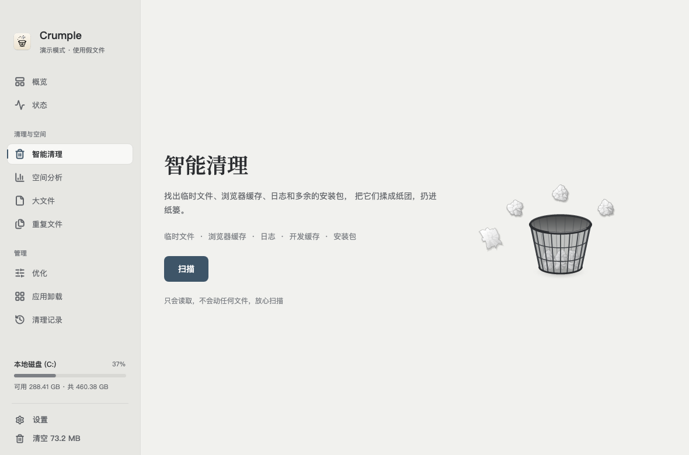

<div align="center">

<br>


# Crumple

### Make room, gently.

A desktop cleaner with the feel of paper.<br>
Find what you no longer need. Crumple it. Let it go.

<sub>macOS & Windows · English & 简体中文 · Mist, Kraft & Dark</sub>

<br>

**[Download for macOS](https://github.com/Jul11us/Crumple/releases/tag/v1.2.0-macos)** &nbsp; / &nbsp; **[Windows Preview](https://github.com/Jul11us/Crumple/releases/tag/v1.2.0-windows)**

[The experience](#a-small-gesture-a-little-more-space) &nbsp; · &nbsp; [Tools](#everything-in-its-place) &nbsp; · &nbsp; [Build](#under-the-paper) &nbsp; · &nbsp; [简体中文](README.zh-CN.md)

<br>

<picture>
  <source media="(prefers-color-scheme: dark)" srcset="docs/images/crumple-en-dark.png">
  
</picture>

<sub>The real macOS interface, shown with generated demo files.</sub>

</div>

<br>

## A small gesture. A little more space.

Crumple makes tidying a small, deliberate act. Pick up a file: it gathers into a paper ball. Toss it toward the basket: a good shot moves it to the Trash; a miss brings it back. A printed receipt records what changed.

Paper tones, ink, a serif heading. Three considered appearances—Mist, Kraft and Dark—give the files room to speak. The animation follows the action, from the first fold to the last line on the receipt.

## Choose your edition

| | macOS | Windows Preview |
| :--- | :--- | :--- |
| **System** | macOS 14 or later | Windows 10 / 11, x64 |
| **Download** | [Universal DMG](https://github.com/Jul11us/Crumple/releases/download/v1.2.0-macos/Crumple-1.2.0-macOS-universal.dmg) | [Setup exe](https://github.com/Jul11us/Crumple/releases/download/v1.2.0-windows/Crumple-1.2.0-Windows-x64-Setup.exe) · [Standalone exe](https://github.com/Jul11us/Crumple/releases/download/v1.2.0-windows/Crumple-1.2.0-Windows-x64.exe) |
| **Install** | Open the DMG; drag Crumple to Applications | Run Setup, or open the standalone exe |
| **Built with** | SwiftUI & AppKit · Apple silicon and Intel | C# & Avalonia · .NET runtime included |

The macOS build is ad hoc signed and has not been notarized by Apple. The Windows build is unsigned and remains a preview: core tests, interface rendering and demo interactions have been checked on macOS; Windows system integration has not yet been tested on a Windows machine. Each Release includes SHA-256 checksums.

## Everything in its place

| Tool | What it does |
| :--- | :--- |
| **Smart Clean** | Reviews caches, logs, developer downloads, what AI tools leave behind, installers and old downloads, with cleanup locations suited to each system. |
| **Space Lens** | Follows folder sizes, one level at a time. |
| **Large Files** | Finds substantial files in your personal folders. |
| **Duplicates** | Compares samples, then full SHA-256 hashes; suggests one copy to keep. |
| **Uninstaller** | Reviews apps and their related files on macOS; opens the app's registered uninstaller on Windows. |
| **Status & Optimize** | Shows system readings and provides maintenance tools appropriate to the platform. |
| **History & Undo** | Keeps cleanup receipts and restores tracked items while the Trash item and original path are available. |

On macOS, a menu bar panel keeps system readings close at hand. On Windows, the same paper language carries through the desktop interface, basket and receipts.

<details>
<summary><strong>A look at the Windows edition</strong></summary>
<br>

<br>
<sub>Actual Avalonia rendering on macOS for interface verification; this is not a Windows desktop capture.</sub>
</details>

## Care in the defaults

- A scan only reads files. Cleanup follows your selection.
- **Move to Trash** is the default. Files still use disk space until the Trash is emptied.
- Installers and old downloads start unselected. Windows developer caches do, too.
- Caches belonging to running apps are protected from cleanup.
- Cleanup boundaries and ignored folders are checked before files move.
- Demo mode uses generated files and an isolated bin.

macOS also offers an explicit permanent-delete mode through its paper shredder. The Windows preview uses the Recycle Bin and does not provide permanent deletion. Platform behavior and verification details are documented in the [macOS development guide](docs/DEVELOPMENT.zh-CN.md) and [Windows guide](Windows/README.md).

## Under the paper

### macOS

Requires Apple's Command Line Tools and macOS 14+; no third-party packages.

```bash
git clone https://github.com/Jul11us/Crumple.git
cd Crumple
bash scripts/build.sh
open build/Crumple.app
```

```bash
swift test
bash Localization/verify.sh
bash scripts/make-dmg.sh
```

To try generated demo files:

```bash
CRUMPLE_DEMO_HOME=/private/tmp/crumple-demo \
  "build/Crumple.app/Contents/MacOS/Crumple"
```

### Windows

Requires .NET 10 SDK to build; end users do not need to install a runtime. NSIS is optional for producing the Setup exe.

```powershell
powershell -File scripts/build-windows.ps1
```

Cross-build from macOS or Linux:

```bash
bash scripts/build-windows.sh
```

See the [Windows guide](Windows/README.md) for demo rendering, the test script and packaging details. Local validation is recorded in [VALIDATION.md](docs/VALIDATION.md).

## Design notes

The interface review drew on [unslop by Damir Sokolovsky](https://github.com/heydamir/unslop), used under [CC BY 4.0](https://creativecommons.org/licenses/by/4.0/). Adaptation notes and attribution are in [UI direction](docs/UI-DIRECTION.md). Windows bundles the [Lucide](https://lucide.dev) icons and [Noto Serif SC](https://github.com/notofonts/noto-cjk) font; component notices accompany the release.

<br>

<div align="center">
<sub>Crumple · A little less clutter. A little more space.</sub>
</div>
