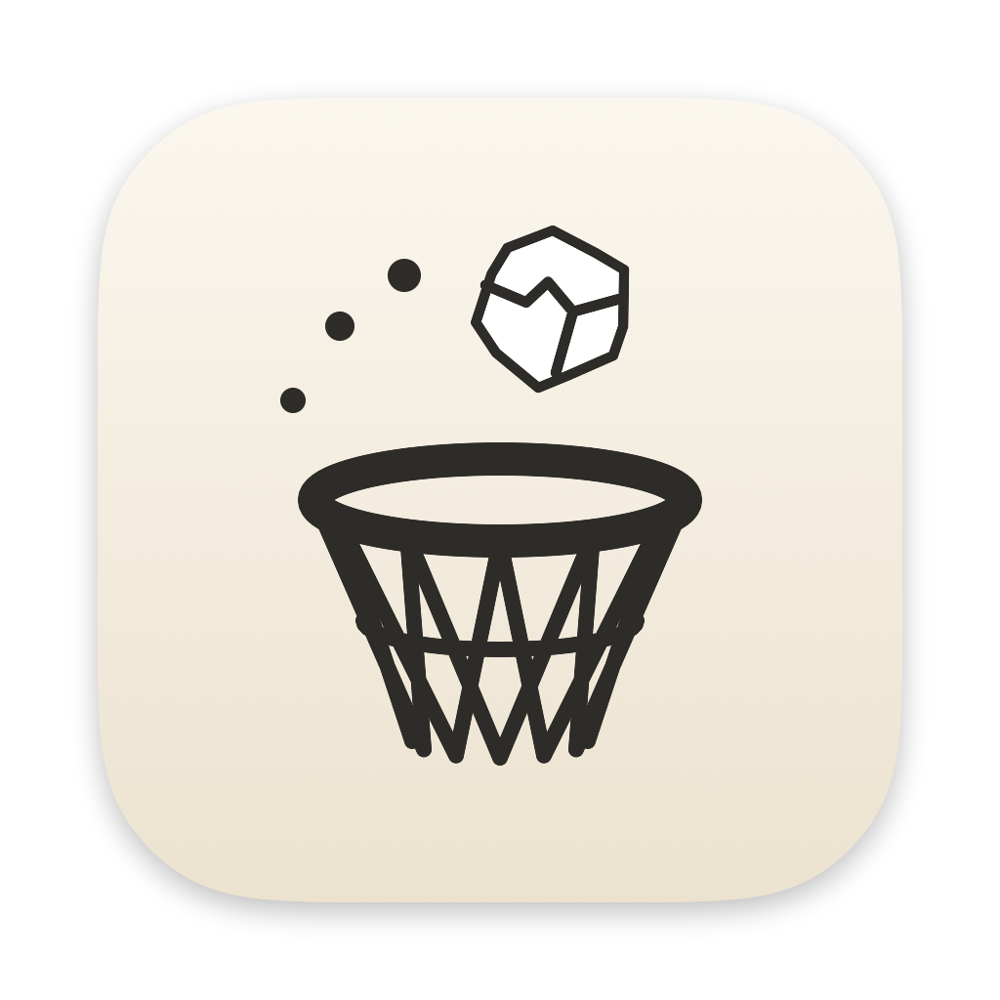
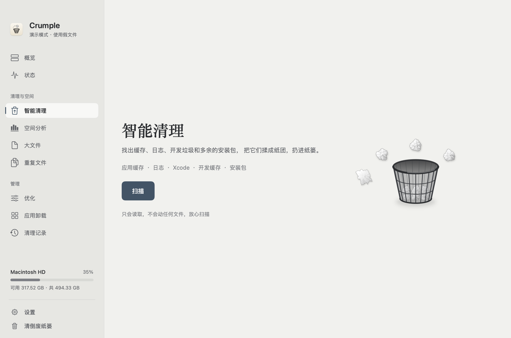

<div align="center">



# Crumple

### 给 Mac，留一点余地。

一个有纸张手感的原生 Mac 清理工具。<br>
把不再需要的文件，揉成纸团，轻轻投进纸篓。

<sub>SwiftUI · macOS 14+ · Apple 芯片与 Intel · 简体中文与 English</sub>

<br><br>

[开始使用](#开始使用) &nbsp; · &nbsp; [功能](#功能) &nbsp; · &nbsp; [English](README.md)

<br>

<picture>
  <source media="(prefers-color-scheme: dark)" srcset="docs/images/crumple-zh-dark.png">
  
</picture>

<sub>真实 SwiftUI 界面，使用演示文件。支持浅色与深色外观。</sub>

</div>

<br>

## 整理空间，也照顾感受

Crumple 把一个熟悉的小动作，带回日常的 Mac 整理。拖起文件，它会在手中皱成纸团；轻轻一甩，纸团沿着弧线落向纸篓。投中，文件移入废纸篓；投偏，它就回到列表。

浅纸色、墨色文字与一抹灰绿，构成安静的界面。动效用来交代每个文件的去向，清理结束后，一张小票缓缓打印出来，记录这次腾出的空间。

## 功能

| 工具 | 可以做什么 |
| :--- | :--- |
| **智能清理** | 检查应用缓存、日志、Xcode 文件、开发工具缓存、安装包与旧下载。 |
| **空间分析** | 从文件夹逐层查看占用，找到空间花在了哪里。 |
| **大文件** | 在个人文件夹中查找大文件，按类型、大小或最近使用时间筛选。 |
| **重复文件** | 先检查大小与抽样内容，再比对完整 SHA-256；为每组文件建议保留一份。 |
| **应用卸载** | 查看第三方应用，以及它们留在资源库中的关联文件。 |
| **状态与优化** | 查看实时系统读数、运行中的应用和后台启动项，按需执行维护。 |
| **记录与撤销** | 保留清理记录；文件仍在废纸篓且原路径未被占用时，可恢复已记录的项目。 |

菜单栏面板让系统状态随手可见。界面支持简体中文与 English，可切换浅色、深色或跟随系统。

## 把分寸放进默认设置

- 扫描只读取文件，选定项目后才开始清理。
- 默认**移到废纸篓**；永久删除需要在设置中另行选择。
- 旧下载、安装包和 Xcode 归档默认不勾选。
- 正在运行的应用，其缓存受到清理保护。
- 路径检查将清理范围限制在家目录两层以下的项目，以及受支持的「应用程序」目录中直接存放的应用。
- 演示模式使用生成的假文件和独立废纸篓，可以先体验揉纸投篓的过程。

## 开始使用

需要 **macOS 14 或更新版本**，以及 Apple **Command Line Tools**。项目使用系统框架，无第三方软件包依赖。

```bash
git clone https://github.com/Jul11us/Crumple.git
cd Crumple
bash scripts/build.sh
open build/Crumple.app
```

生成的应用同时支持 **Apple 芯片和 Intel**。安装到「应用程序」文件夹：

```bash
bash scripts/install.sh
```

### 先投一个纸团

通过独立进程启动演示模式，体验生成的假文件：

```bash
CRUMPLE_DEMO_HOME=/tmp/crumple-demo \
  "build/Crumple.app/Contents/MacOS/Crumple"
```

### 打包安装镜像

```bash
bash scripts/make-dmg.sh
```

生成 `build/releases/Crumple <版本>.dmg`。默认采用本机临时签名，当前默认构建未经 Apple 公证。面向分发的 Developer ID 签名与公证流程由 `scripts/notarize.sh` 提供，需要 Apple 开发者账号。

## 纸张背后

使用 **Swift、SwiftUI 与 AppKit** 构建。扫描与清理引擎、应用状态、纸张绘制与运动，以及原生界面，分别组织在 [`Sources/Crumple`](Sources/Crumple) 下。

```bash
swift test
bash Localization/verify.sh
```

测试覆盖清理路径边界、符号链接、文件恢复、重复文件比对与投掷判定。本地化检查验证打包后的中英文资源，执行前需先运行 `bash scripts/build.sh`。

详细构建说明、只读扫描与界面渲染命令见[开发指南](docs/DEVELOPMENT.zh-CN.md)，验证记录见 [`VALIDATION.md`](docs/VALIDATION.md)。

## 设计手记

Crumple 的识别来自纸张、纸篓，以及一次轻巧而明确的动作。界面审查参考 [Damir Sokolovsky 的 unslop](https://github.com/heydamir/unslop)，遵循 [CC BY 4.0](https://creativecommons.org/licenses/by/4.0/) 署名。适配过程与来源记录见[界面设计方向](docs/UI-DIRECTION.md)。

<br>

<div align="center">
<sub>Crumple · 给日常，多一点留白。</sub>
</div>
